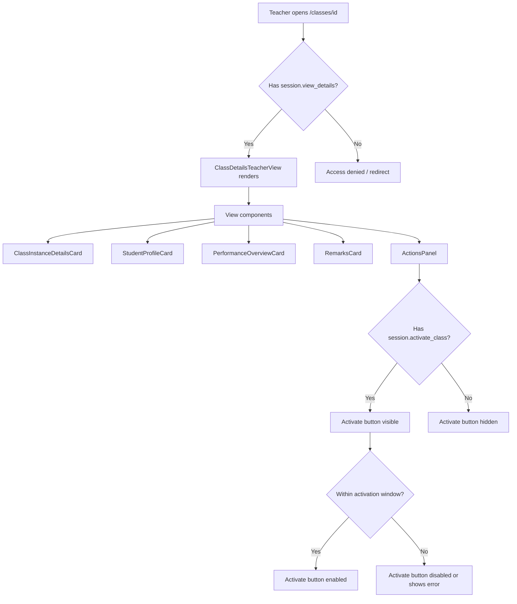

# Teacher Session View (Class Details)

**Route:** `/classes/[id]`
**Permissions:** `session.view_details`, `session.activate_class`
**Role:** Teacher

---

## Flow Diagram

---

## Desktop Scenarios

### D1: Teacher view renders with permission

| Step | Action | Expected |
|------|--------|----------|
| 1 | Login as Teacher (has `session.view_details`) | Dashboard loads |
| 2 | Navigate to `/classes/[id]` for an assigned class | `ClassDetailsTeacherView` renders |
| 3 | Observe page sections | Cards visible: Class Instance Details, Student Profile, Performance Overview, Remarks |

### D2: Teacher view denied without permission

| Step | Action | Expected |
|------|--------|----------|
| 1 | Login as user without `session.view_details` | Dashboard loads |
| 2 | Attempt to navigate to `/classes/[id]` | Access denied message or redirect to dashboard |

### D3: Activate button visible with permission

| Step | Action | Expected |
|------|--------|----------|
| 1 | Login as Teacher (has `session.activate_class`), navigate to `/classes/[id]` | Teacher view renders |
| 2 | Observe the ActionsPanel | Activate button is visible |

### D4: Activate button hidden without permission

| Step | Action | Expected |
|------|--------|----------|
| 1 | Login as Teacher without `session.activate_class`, navigate to `/classes/[id]` | Teacher view renders |
| 2 | Observe the ActionsPanel | Activate button is **not** rendered |

### D5: Activate class within time window

| Step | Action | Expected |
|------|--------|----------|
| 1 | Login as Teacher, navigate to a pending class within activation window (now >= start - 5min, now <= end) | Teacher view with activate button |
| 2 | Click **Activate** | Activation mutation fires |
| 3 | Observe the page | Class status changes to "activated", UI updates |

### D6: Activate class outside time window

| Step | Action | Expected |
|------|--------|----------|
| 1 | Login as Teacher, navigate to a class outside the activation window | Teacher view with activate button |
| 2 | Click **Activate** | Mutation fires but server rejects |
| 3 | Observe error | Localized error message "YOU MISSED THE CLASS TIME" displayed |

### D7: Timezone warning banner

| Step | Action | Expected |
|------|--------|----------|
| 1 | Login as Teacher (has `schedule.view_timezones`), navigate to `/classes/[id]` where student has different timezone | Teacher view renders |
| 2 | Observe the page | `TimezoneWarningBanner` displayed showing timezone difference |

### D8: Timezone warning banner hidden without permission

| Step | Action | Expected |
|------|--------|----------|
| 1 | Login as Teacher without `schedule.view_timezones`, navigate to `/classes/[id]` | Teacher view renders |
| 2 | Observe the page | `TimezoneWarningBanner` is **not** rendered |

---

## Mobile Scenarios

### M1: Teacher view on mobile

| Step | Action | Expected |
|------|--------|----------|
| 1 | Login as Teacher on mobile, navigate to `/classes/[id]` | Teacher view in mobile layout |
| 2 | Observe the page | Cards stack vertically, all information readable |

### M2: Activate button on mobile

| Step | Action | Expected |
|------|--------|----------|
| 1 | Login as Teacher on mobile, navigate to a pending class within window | Mobile teacher view |
| 2 | Tap Activate button | Activation fires, status updates |
| 3 | Observe feedback | Success state shown in mobile layout |

### M3: Activation error on mobile

| Step | Action | Expected |
|------|--------|----------|
| 1 | Login as Teacher on mobile, navigate to class outside window | Mobile teacher view |
| 2 | Tap Activate | Error shown |
| 3 | Observe error | Missed class time error displayed in mobile-friendly banner or toast |

### M4: Timezone banner on mobile

| Step | Action | Expected |
|------|--------|----------|
| 1 | Login as Teacher on mobile with timezone permission, navigate to class with timezone mismatch | Mobile teacher view |
| 2 | Observe the page | Timezone warning banner visible and readable in mobile layout |
