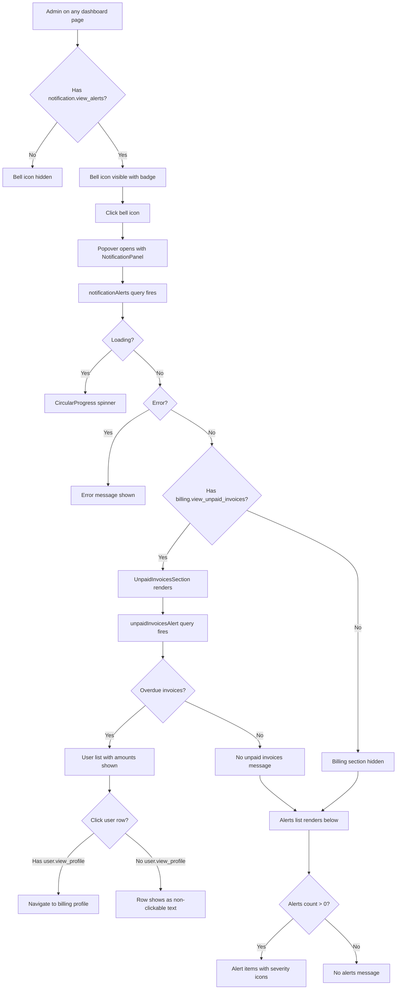

# Notification Panel & Billing Alerts

**Route:** Navbar (all dashboard pages)
**Permissions:** `notification.view_alerts`, `billing.view_unpaid_invoices`, `user.view_profile`
**Roles:** Academy Admin (full access), Teacher (no access), Student (no access)

---

## Flow Diagram

---

## Desktop Scenarios

### D1: Academy Admin sees notification bell icon

| Step | Action | Expected |
|------|--------|----------|
| 1 | Login as Academy Admin | Dashboard loads |
| 2 | Observe navbar | Bell icon (`NotificationsOutlined`) is visible |
| 3 | Check for unread badge | If unread notifications exist, a dot/badge appears on the bell |

### D2: Click bell opens popover with alerts

| Step | Action | Expected |
|------|--------|----------|
| 1 | Login as Academy Admin, observe bell icon | Bell visible in navbar |
| 2 | Click bell icon | Popover opens anchored to bell, bottom-right |
| 3 | Observe popover header | "Notifications" title visible |
| 4 | Observe popover content | Alerts list renders with severity icons (warning, error, info) |
| 5 | Verify alert items | Each alert shows title + truncated body text |

### D3: Billing section shows unpaid invoices count

| Step | Action | Expected |
|------|--------|----------|
| 1 | Login as Academy Admin with `billing.view_unpaid_invoices` | Dashboard loads |
| 2 | Click bell icon | Popover opens |
| 3 | Observe billing section | "Unpaid Invoices" header with `PaymentsOutlined` icon visible |
| 4 | Check badge | Red badge shows count of overdue invoices |
| 5 | Verify user rows | Each row shows user name, amount, currency, and overdue count |

### D4: Click user row navigates to billing profile

| Step | Action | Expected |
|------|--------|----------|
| 1 | Login as Academy Admin with `user.view_profile` | Dashboard loads |
| 2 | Click bell icon → observe billing section | User rows visible |
| 3 | Click a user row | Navigation to `/{locale}/users/{userId}/billing-profile` |
| 4 | Verify billing profile page loads | Page renders with "User Billing Profile" heading |

### D5: Empty state when no alerts and no unpaid invoices

| Step | Action | Expected |
|------|--------|----------|
| 1 | Login as Academy Admin (no unanswered complaints, no overdue invoices) | Dashboard loads |
| 2 | Click bell icon | Popover opens |
| 3 | Observe billing section | "There is no invoices to be paid." message |
| 4 | Observe alerts section | "No alerts at this time." with faded icon |

### D6: Teacher does NOT see bell icon

| Step | Action | Expected |
|------|--------|----------|
| 1 | Login as Teacher | Teacher dashboard loads |
| 2 | Observe navbar | Bell icon is **not** rendered (permission gate hides it) |

### D7: Billing section hidden without billing permission

| Step | Action | Expected |
|------|--------|----------|
| 1 | Login as user with `notification.view_alerts` but without `billing.view_unpaid_invoices` | Dashboard loads |
| 2 | Click bell icon | Popover opens with alerts |
| 3 | Observe popover | "Unpaid Invoices" section is **not** rendered |

---

## Mobile Scenarios

### M1: Bell icon visible in mobile navbar

| Step | Action | Expected |
|------|--------|----------|
| 1 | Login as Academy Admin on mobile viewport | Dashboard loads in mobile layout |
| 2 | Observe mobile navbar | Bell icon is visible (may be in a compact header) |

### M2: Popover renders full-width on mobile

| Step | Action | Expected |
|------|--------|----------|
| 1 | Login as Academy Admin on mobile, tap bell icon | Popover opens |
| 2 | Observe popover | Renders at or near full screen width, scrollable |
| 3 | Observe billing section | Same content as desktop, stacked layout |
