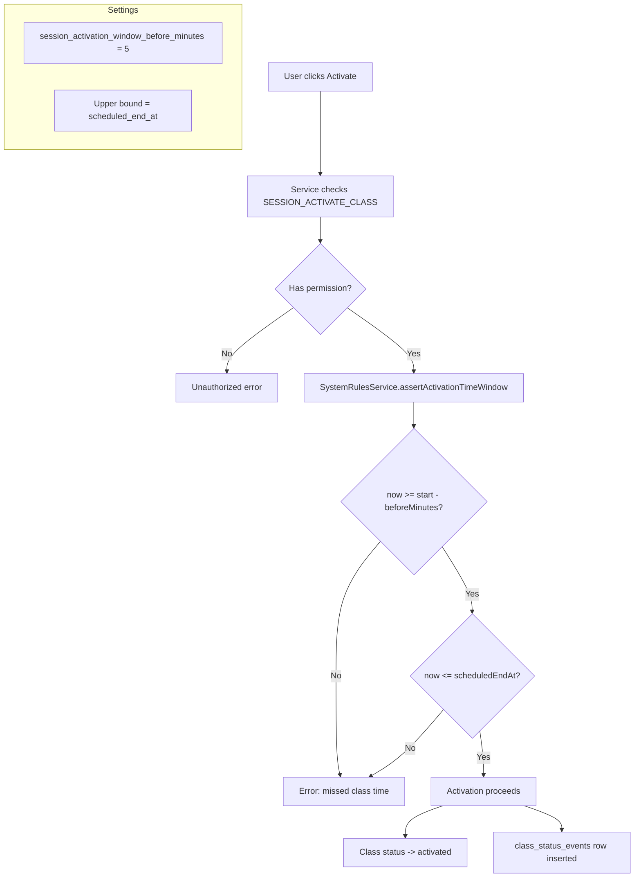

# Activation Time Window Enforcement

**Route:** `/classes/[id]`, `/teachers/dashboard/active`
**Permission:** `system.enforce_time_window` (system-level), `session.activate_class` (user-level)
**Role:** Teacher, Admin

---

## Flow Diagram

---

## Desktop Scenarios

### D1: Activate exactly 5 minutes before start

| Step | Action | Expected |
|------|--------|----------|
| 1 | Login as Teacher, find a class scheduled to start in exactly 5 minutes | Navigate to `/classes/[id]` or active dashboard |
| 2 | Click **Activate** | Activation succeeds (boundary condition: now == start - 5min) |
| 3 | Observe status | Class status changes to "activated" |

### D2: Activate 6 minutes before start (outside window)

| Step | Action | Expected |
|------|--------|----------|
| 1 | Login as Teacher, find a class scheduled to start in 6+ minutes | Navigate to class details |
| 2 | Click **Activate** | Server rejects with "YOU MISSED THE CLASS TIME" error |
| 3 | Observe UI | `MissedClassAlertBanner` or inline error message displayed |

### D3: Activate at exact start time

| Step | Action | Expected |
|------|--------|----------|
| 1 | Login as Teacher, find a class whose start time is now | Navigate to class details |
| 2 | Click **Activate** | Activation succeeds |

### D4: Activate at end time (boundary)

| Step | Action | Expected |
|------|--------|----------|
| 1 | Login as Teacher, find a class whose `scheduled_end_at` is now | Navigate to class details |
| 2 | Click **Activate** | Activation succeeds (boundary: now == scheduledEndAt) |

### D5: Activate after end time (outside window)

| Step | Action | Expected |
|------|--------|----------|
| 1 | Login as Teacher, find a class whose `scheduled_end_at` has passed | Navigate to class details |
| 2 | Click **Activate** | Server rejects with missed class time error |

### D6: Force activate bypasses time window

| Step | Action | Expected |
|------|--------|----------|
| 1 | Login as Admin (has `session.force_activate`), find a class outside the time window | Navigate to `/classes/[id]` |
| 2 | Click **Force Activate** in AdminActionsBar | Activation succeeds regardless of time window |
| 3 | Observe status | Class status changes to "activated" |

### D7: Activation creates status event

| Step | Action | Expected |
|------|--------|----------|
| 1 | Login as Teacher, activate a class within window | Activation succeeds |
| 2 | Check class status events (via history modal download logs or audit) | A `class_status_events` row exists with `from_state: pending` and `to_state: activated` |

### D8: Error message is localized

| Step | Action | Expected |
|------|--------|----------|
| 1 | Login as Teacher with English locale, attempt activation outside window | Error shown in English: "YOU MISSED THE CLASS TIME" |
| 2 | Login as Teacher with Arabic locale, attempt activation outside window | Error shown in Arabic translation |

---

## Mobile Scenarios

### M1: Activation within window on mobile

| Step | Action | Expected |
|------|--------|----------|
| 1 | Login as Teacher on mobile, find a class within activation window | Active dashboard or class details |
| 2 | Tap Activate | Activation succeeds, status updates on mobile |

### M2: Activation outside window on mobile

| Step | Action | Expected |
|------|--------|----------|
| 1 | Login as Teacher on mobile, find a class outside window | Active dashboard or class details |
| 2 | Tap Activate | Error displayed in mobile-friendly format (banner, toast, or alert) |

### M3: Error message readable on mobile

| Step | Action | Expected |
|------|--------|----------|
| 1 | Trigger missed class time error on mobile | Error shown |
| 2 | Observe the error message | Text is fully readable, not truncated, properly localized |
