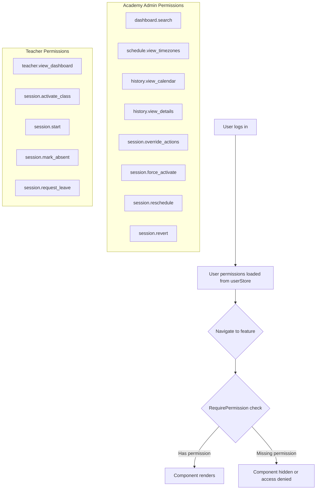

# RBAC Permission Gates

**Routes:** All dashboard routes
**Role:** All roles (Academy Admin, Teacher, Parent, Staff)

---

## Flow Diagram

---

## Permission Matrix

| Permission | Academy Admin | Teacher | Parent | Staff |
|---|---|---|---|---|
| `dashboard.search` | Yes | No | No | No |
| `schedule.view_timezones` | Yes | No | No | No |
| `history.view_calendar` | Yes | No | No | No |
| `history.view_details` | Yes | No | No | No |
| `session.override_actions` | Yes | No | No | No |
| `session.force_activate` | Yes | No | No | No |
| `session.reschedule` | Yes | No | No | No |
| `session.revert` | Yes | No | No | No |
| `session.admin_leave` | Yes | No | No | No |
| `teacher.view_dashboard` | No | Yes | No | No |
| `session.activate_class` | No | Yes | No | No |
| `session.start` | No | Yes | No | No |
| `session.mark_absent` | No | Yes | No | No |
| `session.request_leave` | No | Yes | Yes | No |
| `session.view_details` | Yes | Yes | Yes | Yes |

---

## Desktop Scenarios

### D1: Academy Admin full access

| Step | Action | Expected |
|------|--------|----------|
| 1 | Login as Academy Admin | Dashboard loads |
| 2 | Navigate to `/dashboard` | Search input visible, timezone columns visible |
| 3 | Navigate to `/students/[id]/history` | Calendar grid renders |
| 4 | Click a session in history | ClassDetailsModal opens |
| 5 | Navigate to `/classes/[id]` | AdminActionsBar visible with all override actions |

### D2: Teacher restricted access

| Step | Action | Expected |
|------|--------|----------|
| 1 | Login as Teacher | Dashboard loads |
| 2 | Navigate to `/dashboard` | Search input **hidden**, timezone columns **hidden** |
| 3 | Navigate to `/teachers/dashboard` | Teacher dashboard renders |
| 4 | Navigate to `/students/[id]/history` | Calendar **not** rendered (no `history.view_calendar`) |
| 5 | Navigate to `/classes/[id]` | Teacher view renders (no AdminActionsBar) |

### D3: Parent restricted access

| Step | Action | Expected |
|------|--------|----------|
| 1 | Login as Parent | Dashboard loads |
| 2 | Navigate to `/dashboard` | Search **hidden**, timezone columns **hidden** |
| 3 | Navigate to `/teachers/dashboard` | Access denied (no `teacher.view_dashboard`) |
| 4 | Navigate to `/students/[id]/history` | Calendar **not** rendered |
| 5 | Navigate to `/classes/[id]` | Can view details (has `session.view_details`) but no admin or teacher actions |

### D4: Search permission gate

| Step | Action | Expected |
|------|--------|----------|
| 1 | Login as Academy Admin, go to `/dashboard` | Search input visible |
| 2 | Login as Teacher, go to `/dashboard` | Search input **not** rendered |
| 3 | Login as Parent, go to `/dashboard` | Search input **not** rendered |

### D5: Timezone columns permission gate

| Step | Action | Expected |
|------|--------|----------|
| 1 | Login as Academy Admin, go to `/dashboard` | Three timezone columns in grid |
| 2 | Login as Teacher, go to `/dashboard` | Single time column only |

### D6: Admin override toolbar permission gate

| Step | Action | Expected |
|------|--------|----------|
| 1 | Login as Academy Admin, go to `/classes/[id]` | AdminActionsBar visible |
| 2 | Login as Teacher, go to `/classes/[id]` | AdminActionsBar **not** rendered, ActionsPanel shown instead |

### D7: History calendar permission gate

| Step | Action | Expected |
|------|--------|----------|
| 1 | Login as Academy Admin, go to `/students/[id]/history` | Calendar grid renders |
| 2 | Login as Teacher, go to `/students/[id]/history` | Calendar **not** rendered |

### D8: Session activate permission gate

| Step | Action | Expected |
|------|--------|----------|
| 1 | Login as Teacher (has `session.activate_class`), go to `/classes/[id]` | Activate button visible in ActionsPanel |
| 2 | Login as Teacher without `session.activate_class`, go to `/classes/[id]` | Activate button **not** rendered |

---

## Mobile Scenarios

### M1: Academy Admin mobile full access

| Step | Action | Expected |
|------|--------|----------|
| 1 | Login as Academy Admin on mobile | Mobile dashboard |
| 2 | Navigate to `/dashboard` | Search visible, timezone info in cards |
| 3 | Navigate to `/students/[id]/history` | Mobile weekly scroller renders |
| 4 | Navigate to `/classes/[id]` | Admin actions accessible |

### M2: Teacher mobile restricted access

| Step | Action | Expected |
|------|--------|----------|
| 1 | Login as Teacher on mobile | Mobile dashboard |
| 2 | Navigate to `/dashboard` | Search **hidden**, single time in cards |
| 3 | Navigate to `/teachers/dashboard` | Teacher dashboard renders in mobile |
| 4 | Navigate to `/classes/[id]` | Teacher view, no admin actions |

### M3: Permission-gated elements not in DOM

| Step | Action | Expected |
|------|--------|----------|
| 1 | Login as Teacher on mobile, go to `/dashboard` | Mobile layout |
| 2 | Inspect page source / DOM | Search input element is **not** in the DOM (not just hidden via CSS) |
