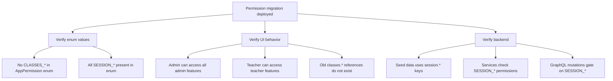

# Session Permission Migration (classes.* -> session.*)

**Scope:** Entire application
**Type:** Regression verification after `classes.*` to `session.*` rename

---

## Flow Diagram

---

## Desktop Scenarios

### D1: Admin permissions work after migration

| Step | Action | Expected |
|------|--------|----------|
| 1 | Login as Admin | Dashboard loads without errors |
| 2 | Use search on `/dashboard` | Search works (gated by `dashboard.search`) |
| 3 | View timezone columns | Columns render (gated by `schedule.view_timezones`) |
| 4 | Access `/classes/[id]` and use AdminActionsBar | All override actions work (gated by `session.override_actions`) |
| 5 | Force activate a class | Works (gated by `session.force_activate`) |
| 6 | Access student history calendar | Calendar renders (gated by `history.view_calendar`) |
| 7 | Open session details modal in history | Modal opens (gated by `history.view_details`) |

### D2: Teacher permissions work after migration

| Step | Action | Expected |
|------|--------|----------|
| 1 | Login as Teacher | Dashboard loads |
| 2 | Access `/teachers/dashboard` | Teacher dashboard renders (gated by `teacher.view_dashboard`) |
| 3 | Activate a class within window | Activation works (gated by `session.activate_class`) |
| 4 | View class details at `/classes/[id]` | Teacher view renders (gated by `session.view_details`) |
| 5 | Request leave on a class | Leave request works (gated by `session.request_leave`) |

### D3: No stale `classes.*` permission errors

| Step | Action | Expected |
|------|--------|----------|
| 1 | Login as any role | No console errors about missing `classes.*` permissions |
| 2 | Navigate through all dashboard pages | No 403 or permission-not-found errors in network tab |
| 3 | Perform all available actions | No backend errors referencing deprecated `classes.*` permission keys |

### D4: GraphQL mutations use new permission keys

| Step | Action | Expected |
|------|--------|----------|
| 1 | Login as Teacher, activate a class | Network tab shows `activateClass` mutation succeeds |
| 2 | Login as Admin, force activate | Network tab shows `forceActivateClass` mutation succeeds |
| 3 | Login as Admin, stop a class | Network tab shows `stopClass` mutation succeeds |
| 4 | Login as Admin, delete a class | Network tab shows `deleteClassInstance` mutation succeeds |

---

## Mobile Scenarios

### M1: All features work on mobile after migration

| Step | Action | Expected |
|------|--------|----------|
| 1 | Login as Admin on mobile | Mobile dashboard loads |
| 2 | Navigate through all available pages | No permission errors, all features accessible |
| 3 | Login as Teacher on mobile | Teacher dashboard accessible |
| 4 | Activate a class on mobile | Activation works with new `session.activate_class` permission |

### M2: No UI regressions on mobile

| Step | Action | Expected |
|------|--------|----------|
| 1 | Login as each role on mobile | No layout breaks or missing elements |
| 2 | All permission-gated elements render correctly | Same visibility rules as desktop |
