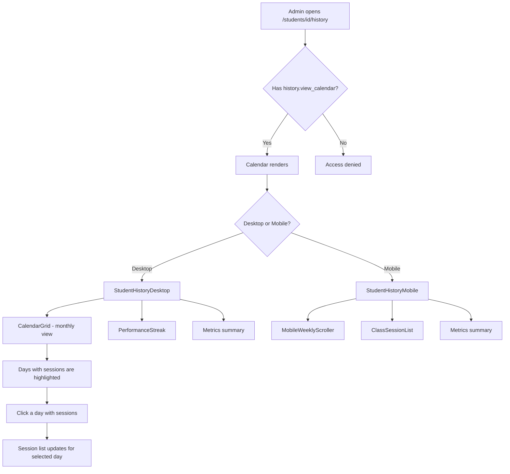

# Student History Calendar View

**Route:** `/students/[id]/history`
**Permission:** `history.view_calendar`
**Role:** Academy Admin

---

## Flow Diagram

---

## Desktop Scenarios

### D1: Calendar grid renders for current month

| Step | Action | Expected |
|------|--------|----------|
| 1 | Login as Academy Admin (has `history.view_calendar`) | Dashboard loads |
| 2 | Navigate to `/students/[id]/history` | `StudentHistoryDesktop` renders |
| 3 | Observe CalendarGrid | Monthly calendar grid shown for the current month |
| 4 | Observe header | Student name displayed, month/year selector visible |

### D2: Calendar hidden without permission

| Step | Action | Expected |
|------|--------|----------|
| 1 | Login as user without `history.view_calendar` | Dashboard loads |
| 2 | Navigate to `/students/[id]/history` | Calendar grid is **not** rendered; access denied or empty page |

### D3: Days with sessions are highlighted

| Step | Action | Expected |
|------|--------|----------|
| 1 | Login as Academy Admin, navigate to student history for a month with seeded sessions | Calendar grid renders |
| 2 | Observe calendar days | Days that have class sessions are visually highlighted (colored dot, badge, or background) |

### D4: Select a day to view sessions

| Step | Action | Expected |
|------|--------|----------|
| 1 | Login as Academy Admin, navigate to student history | Calendar shown |
| 2 | Click on a highlighted day | Day is selected (visual active state) |
| 3 | Observe session list area | List of class sessions for that day appears below or beside the calendar |

### D5: Monthly metrics summary

| Step | Action | Expected |
|------|--------|----------|
| 1 | Login as Academy Admin, navigate to student history | Calendar and metrics shown |
| 2 | Observe metrics section | Shows: **Total Classes**, **Attendance Rate**, **Hours Studied**, **Performance** for the selected month |

### D6: Navigate to previous month

| Step | Action | Expected |
|------|--------|----------|
| 1 | Login as Academy Admin, navigate to student history | Current month shown |
| 2 | Click the previous month arrow/button | Calendar updates to previous month |
| 3 | Observe calendar and metrics | Both update to reflect previous month's data |

### D7: Navigate to next month

| Step | Action | Expected |
|------|--------|----------|
| 1 | Login as Academy Admin, navigate to student history | Current month shown |
| 2 | Click the next month arrow/button | Calendar updates to next month |
| 3 | Observe calendar and metrics | Both update to reflect next month's data |

### D8: Empty month shows no sessions

| Step | Action | Expected |
|------|--------|----------|
| 1 | Login as Academy Admin, navigate to student history | Calendar shown |
| 2 | Navigate to a month with no class sessions | Calendar has no highlighted days |
| 3 | Observe metrics | Total Classes = 0, other metrics reflect empty state |

### D9: Performance streak display

| Step | Action | Expected |
|------|--------|----------|
| 1 | Login as Academy Admin, navigate to student history | Desktop view renders |
| 2 | Observe PerformanceStreak component | Streak visualization shown (e.g., consecutive attendance indicator) |

---

## Mobile Scenarios

### M1: Mobile weekly scroller renders

| Step | Action | Expected |
|------|--------|----------|
| 1 | Login as Academy Admin on mobile, navigate to `/students/[id]/history` | `StudentHistoryMobile` renders |
| 2 | Observe the page | `MobileWeeklyScroller` shown with horizontal week navigation |

### M2: Class session list for selected week

| Step | Action | Expected |
|------|--------|----------|
| 1 | Login as Academy Admin on mobile, navigate to student history | Mobile view with weekly scroller |
| 2 | Observe ClassSessionList | Sessions for the selected week listed below the scroller |

### M3: Swipe/scroll between weeks

| Step | Action | Expected |
|------|--------|----------|
| 1 | Login as Academy Admin on mobile, navigate to student history | Weekly scroller shown |
| 2 | Swipe or tap to navigate to previous week | Scroller updates, session list refreshes |
| 3 | Navigate to next week | Scroller and list update accordingly |

### M4: Metrics on mobile

| Step | Action | Expected |
|------|--------|----------|
| 1 | Login as Academy Admin on mobile, navigate to student history | Mobile view renders |
| 2 | Observe metrics section | Total Classes, Attendance Rate, Hours Studied, Performance shown in mobile-friendly cards |

### M5: Empty week on mobile

| Step | Action | Expected |
|------|--------|----------|
| 1 | Login as Academy Admin on mobile, navigate to student history | Mobile view renders |
| 2 | Navigate to a week with no sessions | ClassSessionList shows empty state message |
