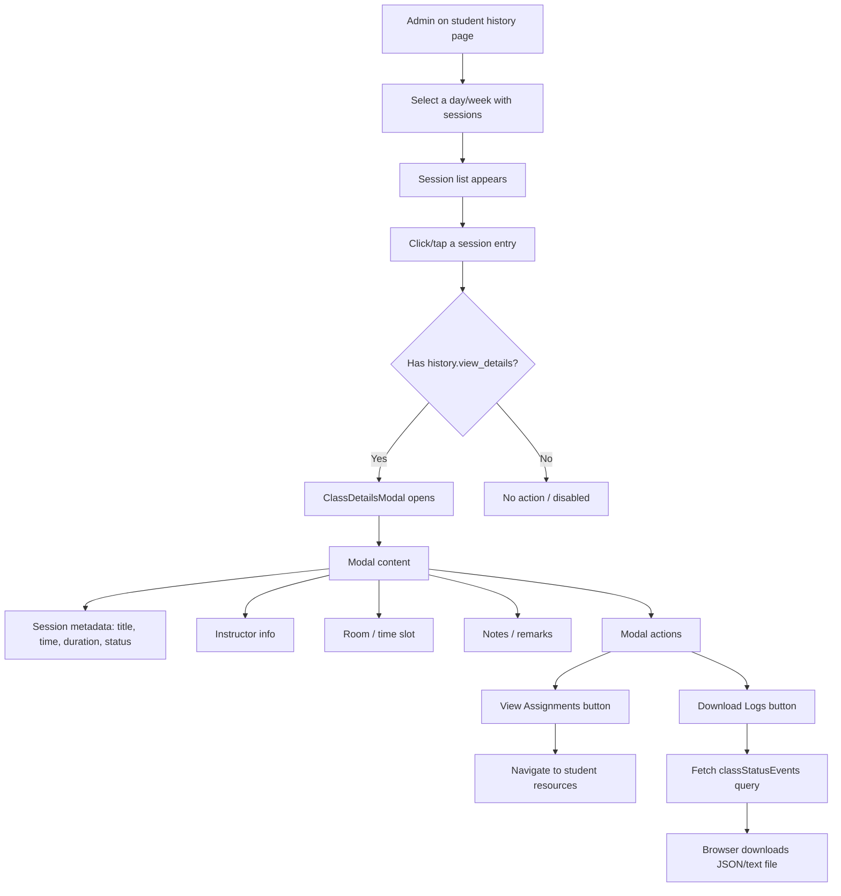

# Session Details Modal (Student History)

**Route:** `/students/[id]/history` (modal overlay, no navigation)
**Permission:** `history.view_details`
**Role:** Admin

---

## Flow Diagram

---

## Desktop Scenarios

### D1: Modal opens on session click with permission

| Step | Action | Expected |
|------|--------|----------|
| 1 | Login as Admin (has `history.view_details`), navigate to `/students/[id]/history` | Calendar and session list shown |
| 2 | Select a day with sessions | Session list updates |
| 3 | Click on a session entry | `ClassDetailsModal` opens as an overlay (no URL change) |

### D2: Modal does not open without permission

| Step | Action | Expected |
|------|--------|----------|
| 1 | Login as user without `history.view_details`, navigate to student history | Calendar shown |
| 2 | Select a day with sessions and click a session entry | Modal does **not** open; session entry may be non-clickable |

### D3: Modal displays session metadata

| Step | Action | Expected |
|------|--------|----------|
| 1 | Open ClassDetailsModal for a completed session | Modal overlay shown |
| 2 | Observe modal content | Displays: session title, scheduled time, duration, status, instructor name, room/time slot, notes/remarks |

### D4: View Assignments button

| Step | Action | Expected |
|------|--------|----------|
| 1 | Open ClassDetailsModal | Modal shown |
| 2 | Click **View Assignments** button | Navigates to student resources page or opens relevant assignment view |

### D5: Download Logs button

| Step | Action | Expected |
|------|--------|----------|
| 1 | Open ClassDetailsModal for a completed session | Modal shown |
| 2 | Click **Download Logs** button | `classStatusEvents` query fires |
| 3 | Observe browser | A file download is triggered (JSON or text format containing status event history) |

### D6: Close modal

| Step | Action | Expected |
|------|--------|----------|
| 1 | Open ClassDetailsModal | Modal overlay shown |
| 2 | Click close button or click outside the modal | Modal closes |
| 3 | Observe the page | Returns to the history calendar view, URL unchanged |

### D7: Modal for session with no remarks

| Step | Action | Expected |
|------|--------|----------|
| 1 | Open ClassDetailsModal for a session without remarks | Modal shown |
| 2 | Observe remarks section | Shows "No remarks" or empty state indicator |

---

## Mobile Scenarios

### M1: Modal opens on mobile tap

| Step | Action | Expected |
|------|--------|----------|
| 1 | Login as Admin on mobile, navigate to student history | Mobile weekly scroller + session list |
| 2 | Tap on a session in the ClassSessionList | `ClassDetailsModal` opens (full-screen overlay or bottom sheet on mobile) |

### M2: Modal content readable on mobile

| Step | Action | Expected |
|------|--------|----------|
| 1 | Open ClassDetailsModal on mobile | Modal overlay shown |
| 2 | Observe content | All metadata (title, time, duration, status, instructor) is readable without horizontal scrolling |

### M3: Download logs on mobile

| Step | Action | Expected |
|------|--------|----------|
| 1 | Open ClassDetailsModal on mobile | Modal shown |
| 2 | Tap **Download Logs** | File download triggered (mobile browser download behavior) |

### M4: Close modal on mobile

| Step | Action | Expected |
|------|--------|----------|
| 1 | Open ClassDetailsModal on mobile | Modal overlay shown |
| 2 | Tap close button or swipe down (if bottom sheet) | Modal closes, returns to history view |
