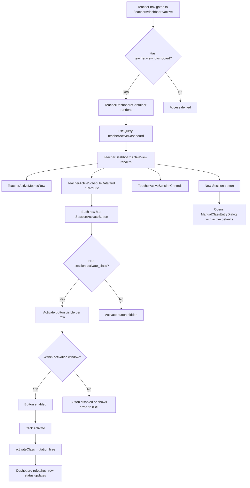

# Teacher Active Dashboard View

**Route:** `/teachers/dashboard/active` (redirects to `?mode=teacher-active`)
**Permission:** `teacher.view_dashboard`, `session.activate_class`
**Role:** Teacher

---

## Flow Diagram

---

## Desktop Scenarios

### D1: Active dashboard renders

| Step | Action | Expected |
|------|--------|----------|
| 1 | Login as Teacher (has `teacher.view_dashboard`), navigate to `/teachers/dashboard/active` | `TeacherDashboardActiveView` renders |
| 2 | Observe page sections | Active metrics row, active schedule data grid, session controls visible |

### D2: Active metrics row

| Step | Action | Expected |
|------|--------|----------|
| 1 | Login as Teacher, navigate to active dashboard | Active view renders |
| 2 | Observe TeacherActiveMetricsRow | Shows active session metrics (active classes count, upcoming, etc.) |

### D3: Session activate button visible per row

| Step | Action | Expected |
|------|--------|----------|
| 1 | Login as Teacher (has `session.activate_class`), navigate to active dashboard | Active schedule grid shown |
| 2 | Observe each row | `SessionActivateButton` visible on each pending class row |

### D4: Session activate button hidden without permission

| Step | Action | Expected |
|------|--------|----------|
| 1 | Login as Teacher without `session.activate_class`, navigate to active dashboard | Active schedule grid shown |
| 2 | Observe each row | `SessionActivateButton` is **not** rendered on any row |

### D5: Activate a class within time window

| Step | Action | Expected |
|------|--------|----------|
| 1 | Login as Teacher, navigate to active dashboard | Active grid with pending classes |
| 2 | Find a class within the activation window (now >= start - 5min, now <= end) | Activate button is enabled |
| 3 | Click **Activate** on that row | `activateClass` mutation fires |
| 4 | Observe the row | Status updates to "activated", button state changes |
| 5 | Observe dashboard | Query refetches, metrics may update |

### D6: Activate a class outside time window

| Step | Action | Expected |
|------|--------|----------|
| 1 | Login as Teacher, navigate to active dashboard | Active grid shown |
| 2 | Find a class outside the activation window | Activate button may appear enabled |
| 3 | Click **Activate** | Mutation fires, server rejects with time window error |
| 4 | Observe error | `MissedClassAlertBanner` or inline error shows "YOU MISSED THE CLASS TIME" |

### D7: Join video button opens Zoom

| Step | Action | Expected |
|------|--------|----------|
| 1 | Login as Teacher, navigate to active dashboard | Active grid with activated classes |
| 2 | Find a row with `zoomMeetingUrl` populated | Join Video button visible |
| 3 | Click **Join Video** | New browser tab opens with the Zoom meeting URL |

### D8: New Session button (active mode)

| Step | Action | Expected |
|------|--------|----------|
| 1 | Login as Teacher, navigate to active dashboard | Active view renders |
| 2 | Click **New Session** button | `ManualClassEntryDialog` opens with active defaults pre-filled |
| 3 | Fill remaining fields and submit | `createTeacherManualClassEntry` mutation fires with active status |
| 4 | Observe result | New active class instance created, appears in the grid |

### D9: Session controls section

| Step | Action | Expected |
|------|--------|----------|
| 1 | Login as Teacher, navigate to active dashboard | Active view renders |
| 2 | Observe TeacherActiveSessionControls | Session control elements (activate, join, etc.) are accessible |

---

## Mobile Scenarios

### M1: Active dashboard on mobile

| Step | Action | Expected |
|------|--------|----------|
| 1 | Login as Teacher on mobile, navigate to `/teachers/dashboard/active` | Active dashboard in mobile layout |
| 2 | Observe the page | Active metrics, schedule card list, and action buttons in mobile layout |

### M2: Activate button on mobile card

| Step | Action | Expected |
|------|--------|----------|
| 1 | Login as Teacher on mobile, navigate to active dashboard | Mobile card list shown |
| 2 | Observe a pending class card | `SessionActivateButton` visible on the card |
| 3 | Tap Activate (within window) | Mutation fires, card status updates |

### M3: Activation error on mobile

| Step | Action | Expected |
|------|--------|----------|
| 1 | Login as Teacher on mobile, navigate to active dashboard | Mobile card list shown |
| 2 | Tap Activate on a class outside time window | Error shown |
| 3 | Observe error | Missed class time alert displayed in mobile-friendly format |

### M4: Join video on mobile

| Step | Action | Expected |
|------|--------|----------|
| 1 | Login as Teacher on mobile, navigate to active dashboard | Mobile cards shown |
| 2 | Tap Join Video on an activated class | Zoom URL opens (new tab or external app prompt on mobile) |

### M5: New Session on mobile

| Step | Action | Expected |
|------|--------|----------|
| 1 | Login as Teacher on mobile, navigate to active dashboard | Mobile view |
| 2 | Tap New Session | Manual entry dialog opens in mobile-friendly format |
| 3 | Fill and submit | New class created, card list updates |
