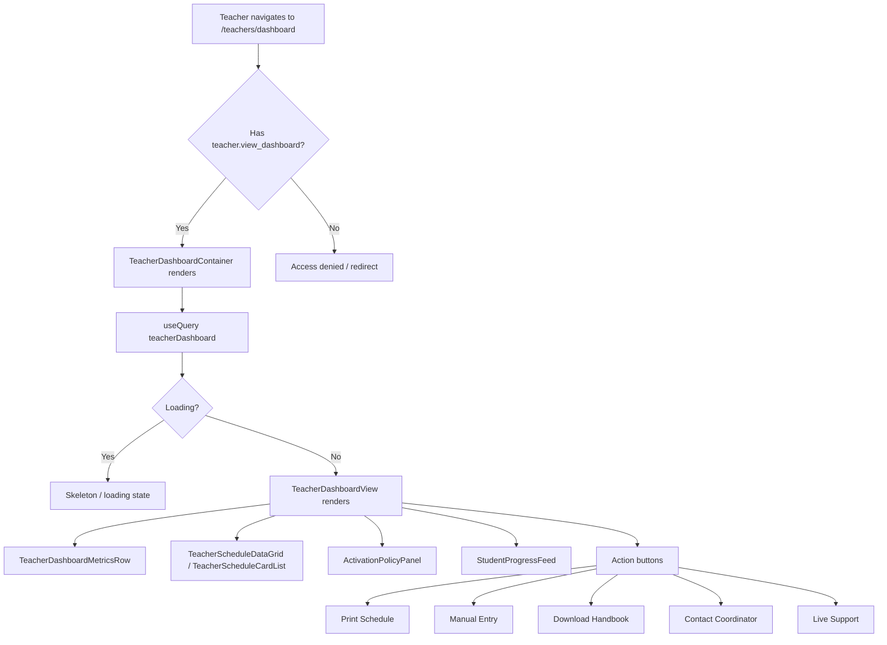

# Teacher Dashboard View

**Route:** `/teachers/dashboard` (redirects to `?mode=teacher`)
**Permission:** `teacher.view_dashboard`
**Role:** Teacher

---

## Flow Diagram

---

## Desktop Scenarios

### D1: Dashboard renders with permission

| Step | Action | Expected |
|------|--------|----------|
| 1 | Login as Teacher (has `teacher.view_dashboard`) | Dashboard loads |
| 2 | Navigate to `/teachers/dashboard` | `TeacherDashboardView` renders |
| 3 | Observe page sections | Metrics row, schedule data grid, activation policy panel, student progress feed all visible |

### D2: Dashboard denied without permission

| Step | Action | Expected |
|------|--------|----------|
| 1 | Login as user without `teacher.view_dashboard` | Dashboard loads |
| 2 | Navigate to `/teachers/dashboard` | Access denied or redirect to main dashboard |

### D3: Metrics row displays data

| Step | Action | Expected |
|------|--------|----------|
| 1 | Login as Teacher, navigate to `/teachers/dashboard` | Dashboard renders |
| 2 | Observe TeacherDashboardMetricsRow | Shows teacher-specific metrics (total classes, active sessions, student count, etc.) |

### D4: Schedule data grid shows teacher's classes

| Step | Action | Expected |
|------|--------|----------|
| 1 | Login as Teacher, navigate to `/teachers/dashboard` | Dashboard renders |
| 2 | Observe TeacherScheduleDataGrid | Grid shows only classes assigned to the logged-in teacher |
| 3 | Verify row data | Each row includes student info, time, status, and zoom meeting URL |

### D5: Print schedule button

| Step | Action | Expected |
|------|--------|----------|
| 1 | Login as Teacher, navigate to `/teachers/dashboard` | Dashboard renders |
| 2 | Click **Print Schedule** button | Browser print dialog opens |
| 3 | Observe print preview | Schedule section is formatted for print; non-essential UI elements hidden via `print:hidden` CSS |

### D6: Manual entry dialog

| Step | Action | Expected |
|------|--------|----------|
| 1 | Login as Teacher, navigate to `/teachers/dashboard` | Dashboard renders |
| 2 | Click **Manual Entry** button | `ManualClassEntryDialog` opens |
| 3 | Fill in the form fields | Form accepts input (student, date, time, duration, etc.) |
| 4 | Submit the form | `createTeacherManualClassEntry` mutation fires |
| 5 | Observe result | New class instance created, dashboard query refetches, new row appears in schedule |

### D7: Download handbook button

| Step | Action | Expected |
|------|--------|----------|
| 1 | Login as Teacher, navigate to `/teachers/dashboard` | Dashboard renders |
| 2 | Click **Download Handbook** button | `teacherHandbookUrl` query fires |
| 3 | Observe browser | New tab opens or file download triggered with the handbook URL |

### D8: Contact coordinator button

| Step | Action | Expected |
|------|--------|----------|
| 1 | Login as Teacher, navigate to `/teachers/dashboard` | Dashboard renders |
| 2 | Click **Contact Coordinator** button | `logTeacherSupportRequest` mutation fires with type `COORDINATOR` |
| 3 | Observe feedback | Success message or confirmation shown |

### D9: Live support button

| Step | Action | Expected |
|------|--------|----------|
| 1 | Login as Teacher, navigate to `/teachers/dashboard` | Dashboard renders |
| 2 | Click **Live Support** button | `logTeacherSupportRequest` mutation fires with type `SUPPORT` |
| 3 | Observe feedback | Success message or confirmation shown |

### D10: Activation policy panel

| Step | Action | Expected |
|------|--------|----------|
| 1 | Login as Teacher, navigate to `/teachers/dashboard` | Dashboard renders |
| 2 | Observe ActivationPolicyPanel | Shows activation time window rules (e.g., "5 minutes before class start") |

### D11: Student progress feed

| Step | Action | Expected |
|------|--------|----------|
| 1 | Login as Teacher, navigate to `/teachers/dashboard` | Dashboard renders |
| 2 | Observe StudentProgressFeed | Shows progress entries for assigned students |

---

## Mobile Scenarios

### M1: Dashboard renders on mobile

| Step | Action | Expected |
|------|--------|----------|
| 1 | Login as Teacher on mobile, navigate to `/teachers/dashboard` | Teacher dashboard in mobile layout |
| 2 | Observe the page | Metrics, schedule cards, and action buttons accessible in mobile layout |

### M2: Schedule as card list on mobile

| Step | Action | Expected |
|------|--------|----------|
| 1 | Login as Teacher on mobile, navigate to `/teachers/dashboard` | Mobile layout |
| 2 | Observe schedule section | `TeacherScheduleCardList` renders (cards instead of data grid) |

### M3: Manual entry on mobile

| Step | Action | Expected |
|------|--------|----------|
| 1 | Login as Teacher on mobile, navigate to `/teachers/dashboard` | Mobile layout |
| 2 | Tap **Manual Entry** | Dialog opens in mobile-friendly format |
| 3 | Fill and submit | Mutation fires, new entry created |

### M4: Action buttons accessible on mobile

| Step | Action | Expected |
|------|--------|----------|
| 1 | Login as Teacher on mobile, navigate to `/teachers/dashboard` | Mobile layout |
| 2 | Observe action buttons | Print, Handbook, Coordinator, Support buttons are accessible and tappable |
