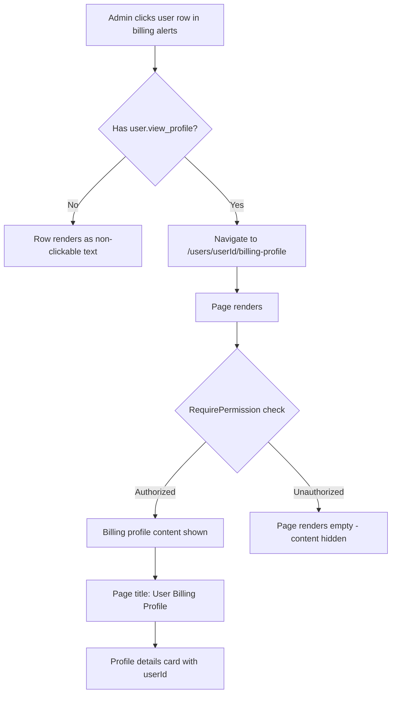

# User Billing Profile

**Route:** `/users/[id]/billing-profile`
**Permission:** `user.view_profile`
**Roles:** Academy Admin (access), Teacher (no access), Student (no access)

---

## Flow Diagram

---

## Desktop Scenarios

### D1: Academy Admin accesses billing profile page

| Step | Action | Expected |
|------|--------|----------|
| 1 | Login as Academy Admin with `user.view_profile` | Dashboard loads |
| 2 | Navigate to `/users/{validUserId}/billing-profile` | Page loads |
| 3 | Observe page title | "User Billing Profile" heading visible |
| 4 | Observe profile card | "Billing profile details for user {userId}" text visible |

### D2: Invalid user ID shows error

| Step | Action | Expected |
|------|--------|----------|
| 1 | Login as Academy Admin, navigate to `/users//billing-profile` (empty ID) | Page loads |
| 2 | Observe page | "Invalid User ID" error message displayed |

### D3: Teacher role sees access denied

| Step | Action | Expected |
|------|--------|----------|
| 1 | Login as Teacher | Teacher dashboard loads |
| 2 | Navigate to `/users/{userId}/billing-profile` | Page loads |
| 3 | Observe page | Page renders empty (RequirePermission hides all content) |
| 4 | Verify | No "User Billing Profile" heading or profile card visible |

### D4: Navigation from notification panel

| Step | Action | Expected |
|------|--------|----------|
| 1 | Login as Academy Admin with all 3 permissions | Dashboard loads |
| 2 | Click bell icon → observe billing section | Unpaid invoices list visible |
| 3 | Click a user row | URL changes to `/{locale}/users/{userId}/billing-profile` |
| 4 | Verify billing profile page | Page renders with correct user ID |
