# Accounting workflow journey diagrams

Mermaid diagrams for the cross-actor journey suites in this directory. Each section maps to one test file and uses the same actor names, service entry points, and event types as the journey code.

## record-payment-balance-visibility.test.ts

An academy admin records a paid hour-package payment; the invoice, payment row, hour-ledger PURCHASE row, and the student's denormalized balance facets all land in one transaction. The student and linked parent read the new balance, view-only staff read the payment row, unrelated actors are denied everywhere, and the ACCOUNTING_PAYMENT_RECORDED notification reaches only the student and the linked parent.

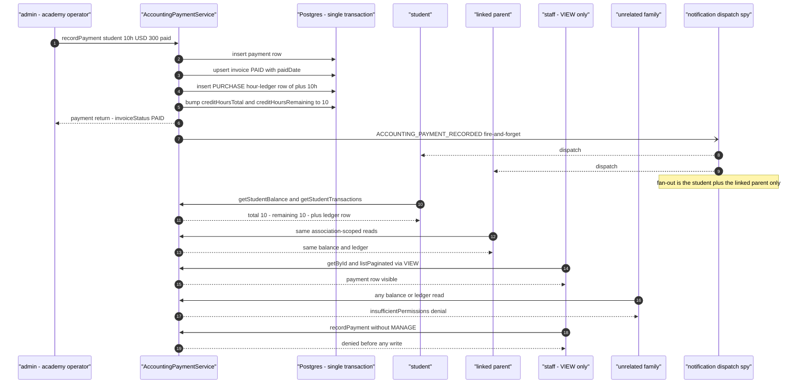

## toggle-paid-invoice-cascade.test.ts

The paid-sibling rule drives the invoice status: an invoice stays PAID while any sibling payment is paid, flips to UNPAID when the last paid sibling is toggled off, and returns to PAID when one is toggled back on. The `accounting_paid_toggle_auto_flips_invoice` setting decouples the flags entirely, and a stale `expectedInvoiceVersion` is rejected before any write.

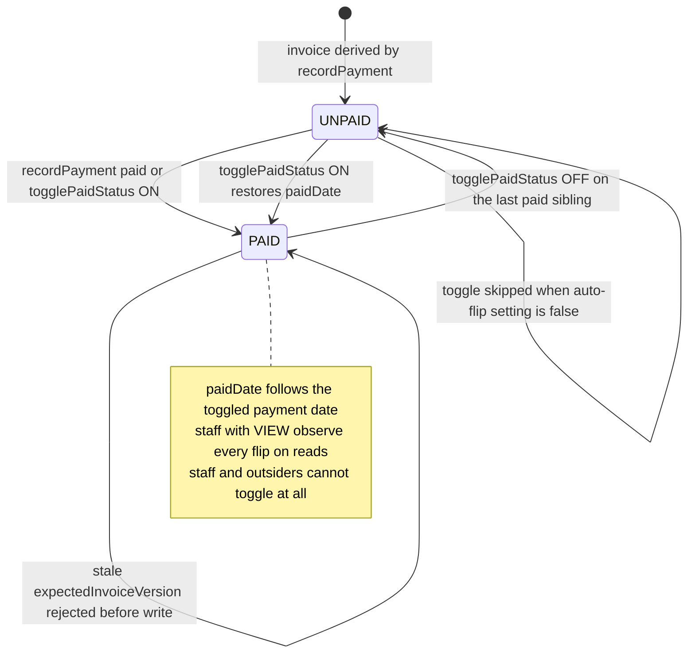

## edit-payment-hours-adjustment.test.ts

Editing a payment's creditHours writes an ADJUSTMENT hour-ledger row carrying the signed delta and moves the balance facets; note-only and unchanged-hours edits write nothing. A decrease past the available balance raises a ConflictError with a full rollback, and actors without ACCOUNTING_PAYMENTS_MANAGE are denied before any write.

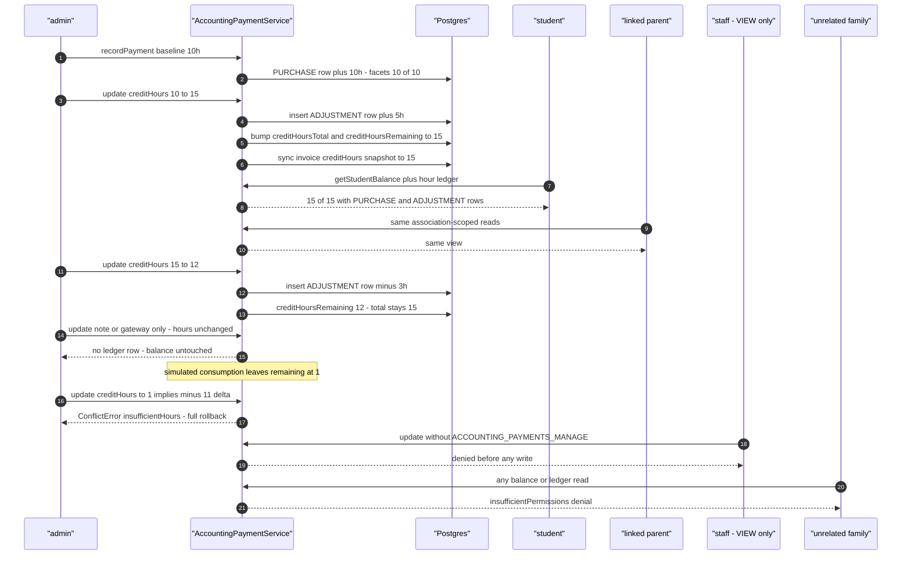

## low-hours-notification.test.ts

Hour deductions via `deductHoursForBooking` move the balance down; the post-commit probe `maybeNotifyLowHours` fires ACCOUNTING_LOW_HOURS only when the balance lands at or below the configured threshold. The alert targets the student and the linked parent only — admin fan-out is deferred — and a rejected deduction never triggers it.

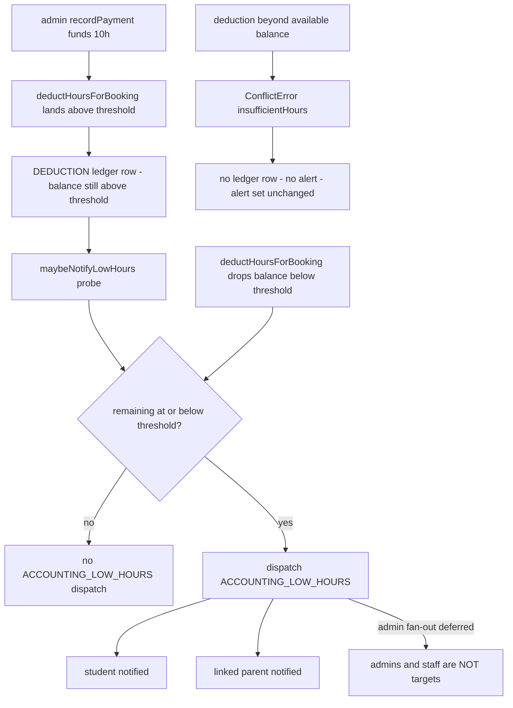

## session-audit-access-isolation.test.ts

An academy_admin accounting operator reads the session audit report scoped to one teacher and receives exactly that teacher's rows (further narrowed by student, status, and date filters), while teacher- and student-role actors are denied with FORBIDDEN before any read or log line — even when filtering by their own ids. Every successful read emits the structured audit log, and the export-shaped read carries the totalCount the CSV route's truncation header encodes.

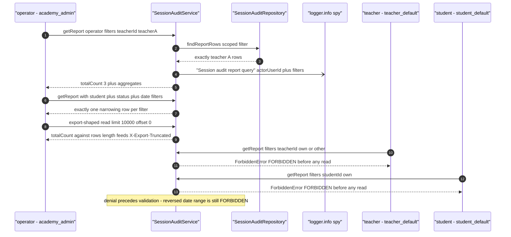

## session-audit-session-lifecycle.test.ts

A teacher activates and joins the on-time session (`activate` + `updateStatusStart` — RUNNING, `actual_start_at` set, audit status still `open`), the operator's terminal `stop` resolves COMPLETED/TAKEN so the row reads `end` with the auto-calculated payroll snapshot attached, and a service-driven absence lands absent-with-start so the mapper yields `absent_student`, while the telemetry-less COMPLETED/ABSENT cast row maps to `Absent`. The accounting operator reads each transition back through `SessionAuditService.getReport` pinned to the shared mapper, scoped filters never leak the second teacher's rows, actors without `ACCOUNTING_REPORTS_VIEW` are rejected FORBIDDEN, report reads never dispatch notifications, and teacher/student-facing detail surfaces stay payroll-blind after the snapshot lands.

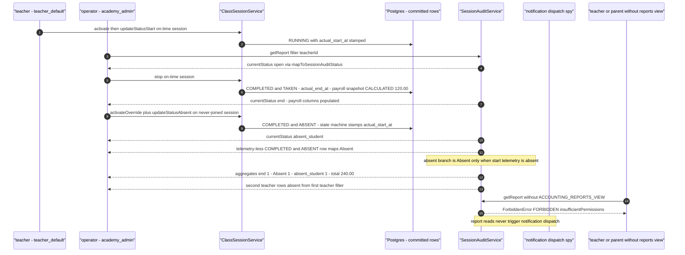

## session-audit-payroll-visibility.test.ts

The payroll write path (auto-calculation at the terminal stop, operator override to PARTIALLY 50%, lesson-report approval to WAITING_PAID, dues settlement to PAID) mutates the payroll snapshot columns, and the accounting operator's read-only `SessionAuditService.getReport` plus the CSV serialization reflect every post-override value with correct aggregates; the payment-date tooltip appears only on the PAID row, and actors without `ACCOUNTING_REPORTS_VIEW` are denied before any read.

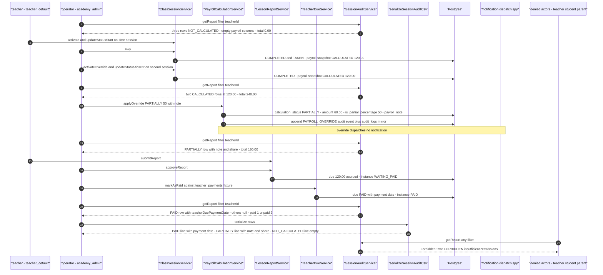

## carryover-to-expense.journey.test.ts

The teacher drives telemetry so both sessions land CALCULATED (on-time stop, then an absent resolution via `activateOverride`/`updateStatusAbsent`), the accounting operator aggregates both into one carryover via `CarryoverBalanceService.bulkCreateCarryoverBalances` (sessions WAITING_PAID, one CARRYOVER_CREATE audit row), then settles it via `bulkCarryoverToExpense` (carryover isPaid with payment date and expense reference, both sessions PAID with a settlement event each, one CARRYOVER_TO_EXPENSE audit row carrying the full expense payload in metadata — the ledger adapter persists no rows of its own). A same-payload re-submit replays the first result with no audit or ledger growth, a second operator's concurrent settle is denied as already-paid, and the read-only auditor (custom VIEW-only group) reads the paid row and its drill-down sessions while remaining locked out of the settle surface.

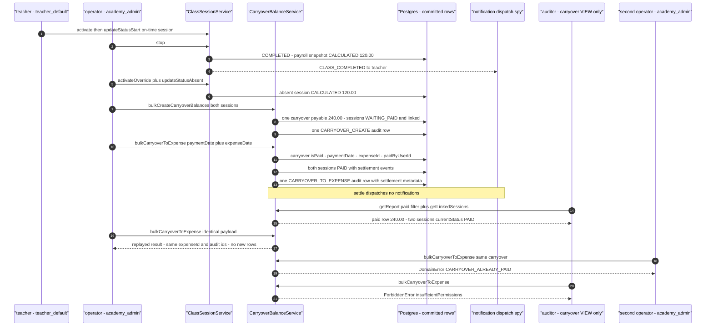

## carryover-bulk-create.journey.test.ts

An accounting operator bulk-creates carryover balances from audited sessions: the sessions link to one carryover per teacher and flip to WAITING_PAID, one CARRYOVER_CREATE audit row lands per carryover plus a PAYROLL_STATUS_TRANSITION event per session, and the linked state is readable by the second operator and a view-only carryover auditor while teachers are denied everywhere. Re-selections are rejected honestly (already-linked on the legacy-linked row, not-audited on the linked set), and the flow dispatches no notifications.

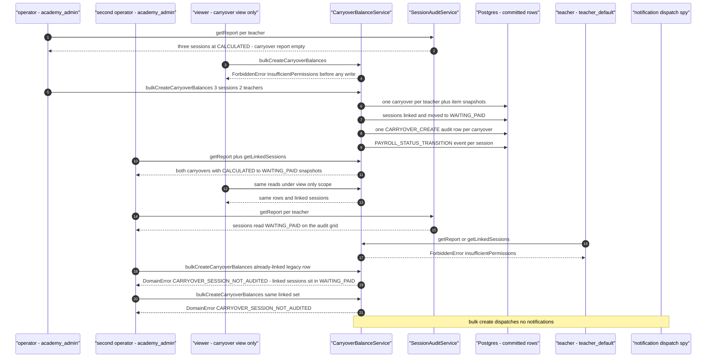

## carryover-unpay.journey.test.ts

The accounting operator aggregates two audited sessions into one unpaid carryover, converts it to an expense (carryover paid with an expense reference, sessions PAID), then unpays it — the missing/expense-soft-delete-tolerant ledger revert clears every settlement field and returns the sessions to WAITING_PAID while the append-only audit trail keeps create, settle, and unpay rows; denials reject a double reversal and any actor without `ACCOUNTING_CARRYOVER_MANAGE`.

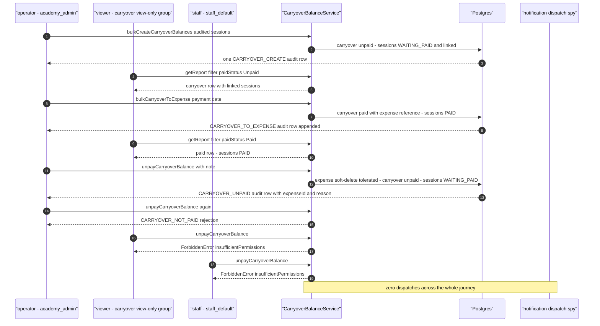

## carryover-delete.journey.test.ts

An accounting operator aggregates audited sessions into per-teacher carryovers, then deletes teacher A's carryover: the linked sessions detach and revert to their per-item `originalStatus` snapshots, the deleted carryover disappears from the report while its `CARRYOVER_CREATE` and `CARRYOVER_DELETE` audit rows survive, and a second operator immediately re-selects the freed sessions into a new carryover that the first operator can read. Teacher B's carryover settles to expense and is then protected: single delete rejects with `CARRYOVER_PAID_CANNOT_DELETE`, a bulk delete mixing the paid row rolls the whole batch back, and a view-only staff actor is denied before any row moves.

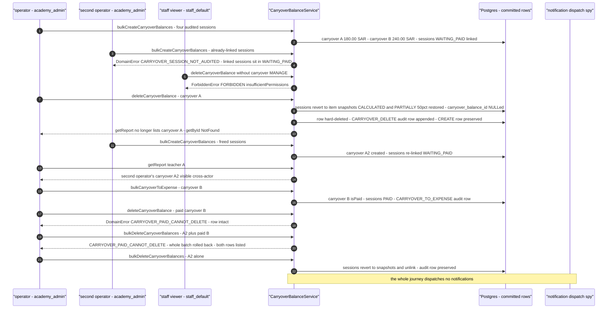
