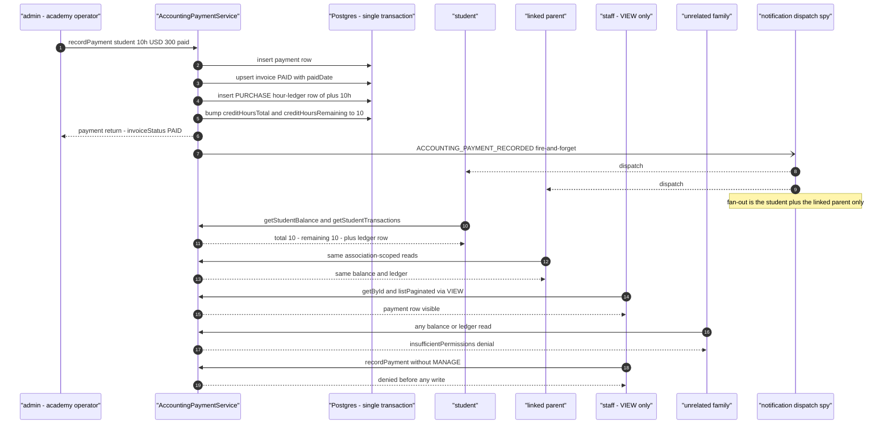
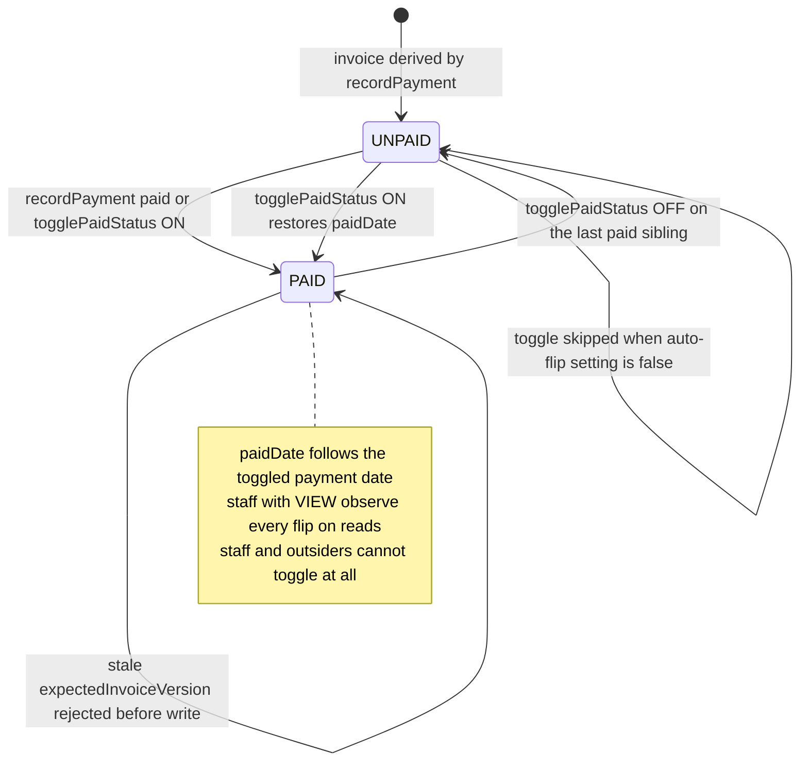
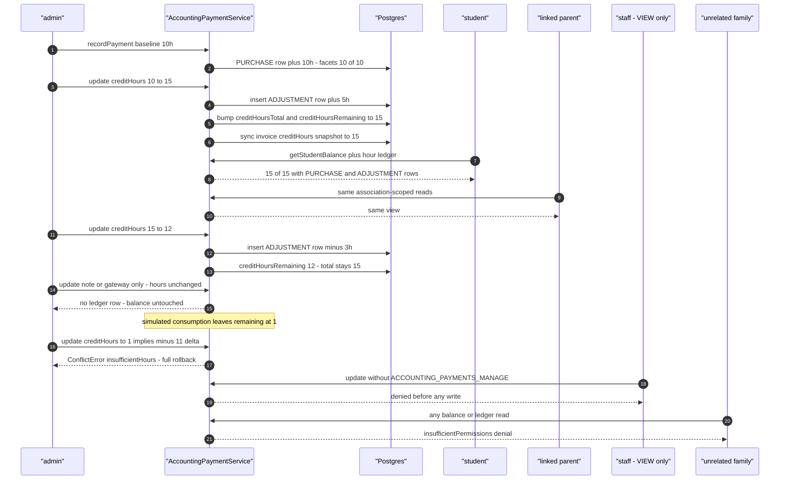
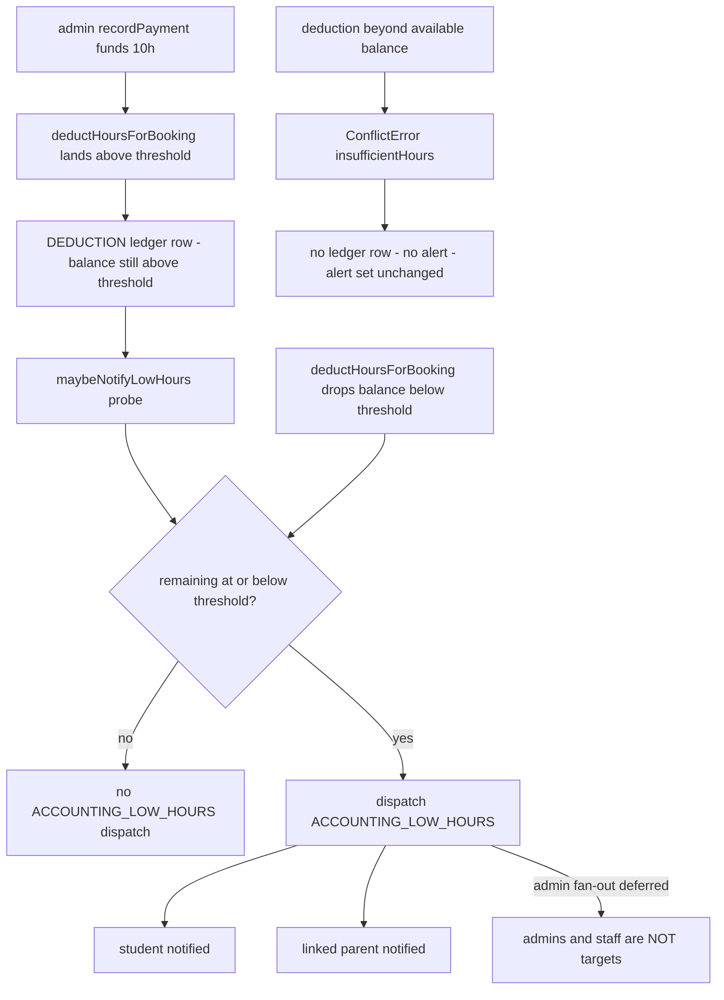

# Accounting workflow journey diagrams

Mermaid diagrams for the cross-actor journey suites in this directory. Each section maps to one test file and uses the same actor names, service entry points, and event types as the journey code.

## record-payment-balance-visibility.test.ts

An academy admin records a paid hour-package payment; the invoice, payment row, hour-ledger PURCHASE row, and the student's denormalized balance facets all land in one transaction. The student and linked parent read the new balance, view-only staff read the payment row, unrelated actors are denied everywhere, and the ACCOUNTING_PAYMENT_RECORDED notification reaches only the student and the linked parent.

## toggle-paid-invoice-cascade.test.ts

The paid-sibling rule drives the invoice status: an invoice stays PAID while any sibling payment is paid, flips to UNPAID when the last paid sibling is toggled off, and returns to PAID when one is toggled back on. The `accounting_paid_toggle_auto_flips_invoice` setting decouples the flags entirely, and a stale `expectedInvoiceVersion` is rejected before any write.

## edit-payment-hours-adjustment.test.ts

Editing a payment's creditHours writes an ADJUSTMENT hour-ledger row carrying the signed delta and moves the balance facets; note-only and unchanged-hours edits write nothing. A decrease past the available balance raises a ConflictError with a full rollback, and actors without ACCOUNTING_PAYMENTS_MANAGE are denied before any write.

## low-hours-notification.test.ts

Hour deductions via `deductHoursForBooking` move the balance down; the post-commit probe `maybeNotifyLowHours` fires ACCOUNTING_LOW_HOURS only when the balance lands at or below the configured threshold. The alert targets the student and the linked parent only — admin fan-out is deferred — and a rejected deduction never triggers it.

