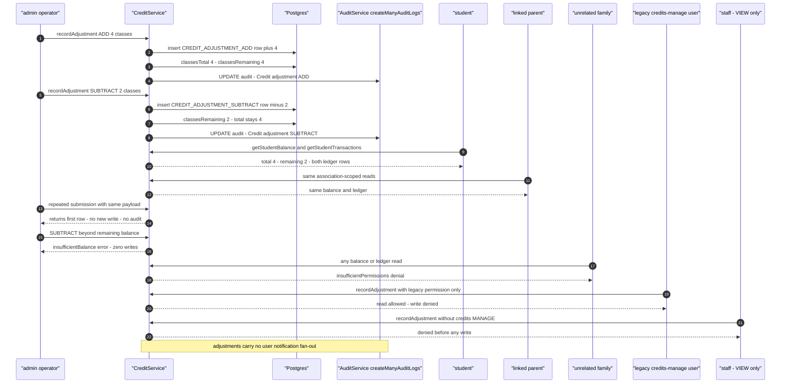
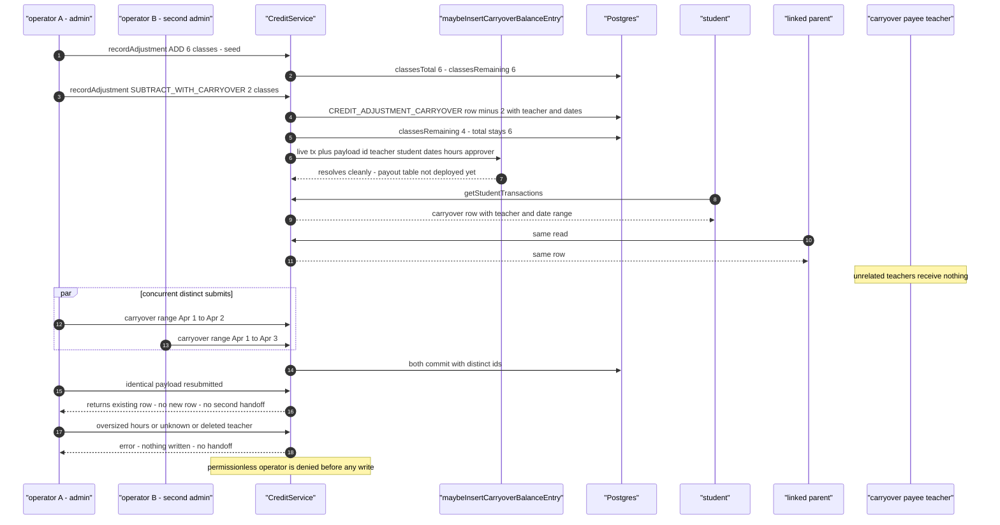
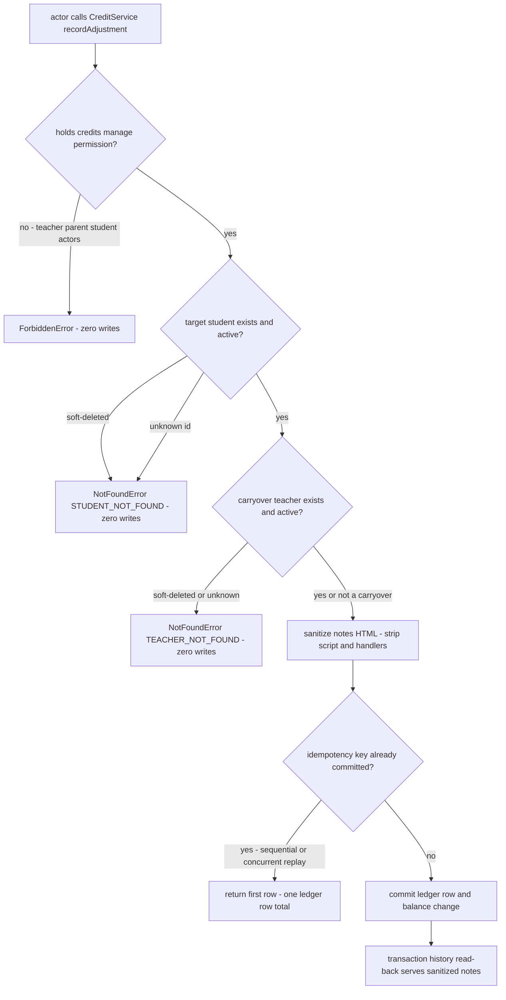

# Billing workflow journey diagrams

Mermaid diagrams for the credit-adjustment journey suites in this directory. Each section maps to one test file and uses the same actor names, service entry points, and ledger reasons as the journey code.

## credit-adjustment-student-visibility.test.ts

An admin operator records Add and Subtract adjustments through `recordAdjustment`; each commits a signed ledger row and moves the student's class balance. The student and linked parent observe both rows, repeated submissions collapse onto the first row, oversized subtractions and actors without the manage permission write nothing, and every committed adjustment emits an audit entry with no user notification.

## credit-adjustment-carryover.test.ts

Subtract-with-carryover adjustments deduct the student's classes, stamp the carryover teacher and date-range columns on the ledger row, and hand the payout metadata to the carryover settlement boundary inside the same transaction. Concurrent operators both commit, an identical resubmission reuses the first row without a second handoff, and every denial path writes nothing.

## credit-adjustment-security.test.ts

Adversarial probes against the real service stack: actors with real teacher, parent, or student permission groups are denied; adjustments against soft-deleted or unknown students and carryover teachers raise NotFoundError with zero writes; sequential and concurrent double-submits collapse onto one ledger row; and hostile notes are sanitized before persistence and read back sanitized.

