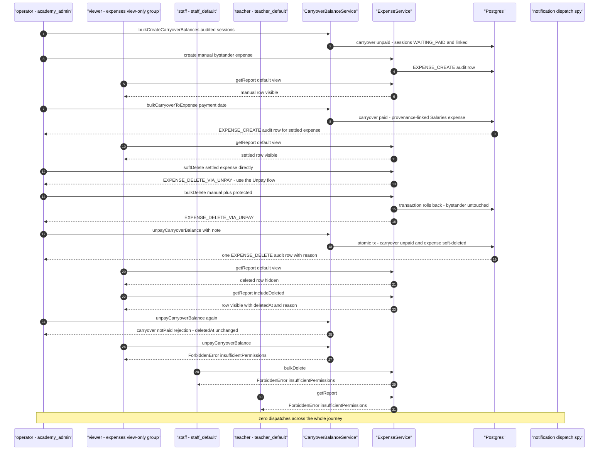

# Expenses workflow journey diagrams

Mermaid diagrams for the cross-actor journey suites in this directory. Each section maps to one test file and uses the same actor names, service entry points, and event types as the journey code.

## carryover-unpay-expense-softdelete.test.ts

The accounting operator aggregates two audited sessions into an unpaid carryover, adds a manual bystander expense, and settles the carryover to a provenance-linked Salaries expense. While the carryover is paid the row is protected: a direct soft-delete rejects `EXPENSE_DELETE_VIA_UNPAY` and a bulk delete containing it rolls back atomically, leaving the bystander untouched. Un paying the carryover soft-deletes the expense in the same transaction, the default ledger view hides it while `includeDeleted` keeps it with its deletion marker, and exactly one EXPENSE_DELETE audit row carries the unpay note; double-reversal and view-only/staff/teacher denials leave the state untouched.

