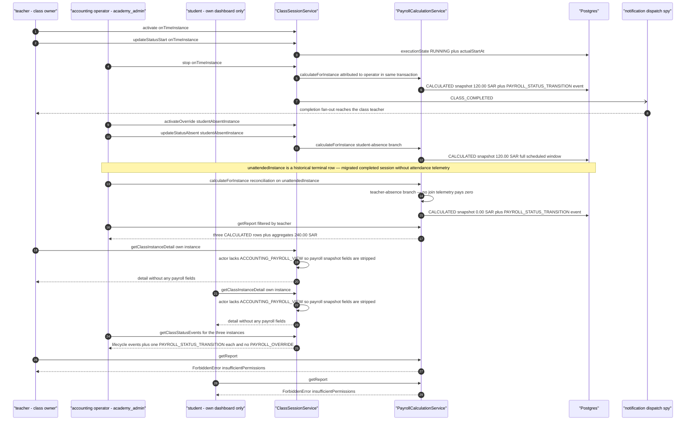
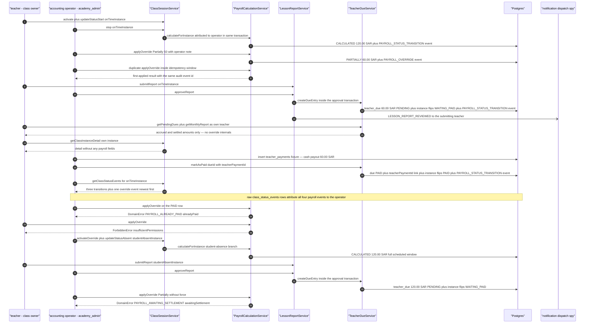
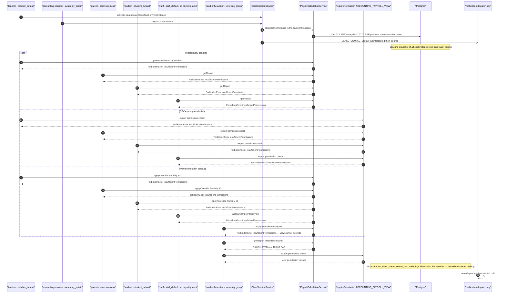

# Payroll workflow journey diagrams

Mermaid diagram for the cross-actor journey suite in this directory, using the same actor names, service entry points, and statuses as the journey code.

## auto-calculation-to-payroll-visibility.test.ts

The teacher drives a scheduled session through the real state machine with their attendance telemetry, and the operator's terminal transitions fire the automatic payroll calculation inside the same transaction as the state change; the unattended historical row (migrated terminal session without attendance telemetry) is settled separately through the operator's standalone reconciliation calculation. The accounting operator then reads the calculated rows through the report service, teacher and student class-detail surfaces stay payroll-blind, the audit trail carries exactly one status-transition event per calculation and no override events, and unauthorized actors are denied.

## override-to-settlement-lifecycle.test.ts

The operator overrides a calculated session to Partially 50%, the teacher's lesson report is approved so the due accrues from the overridden amount and the instance flips to WAITING_PAID inside the approval transaction, the operator settles the due against a recorded teacher payment (PAID flip plus teacherPaymentId link in one transaction), the audit trail attributes every payroll event to the operator while the teacher sees only their settled dues, and settled or awaiting rows reject further overrides.

## payroll-permission-denials.test.ts

Every payroll surface — the report query service, the CSV export permission gate, and the override mutation — rejects actors without the matching payroll permission before any row is read or written. The journey lands one calculated baseline row, then the teacher, parent, student, and a non-payroll staff actor probe all three surfaces, and a view-only auditor proves view access covers reads and the export gate but never the override mutation; instance rows, event history, the audit trail, and the notification fan-out stay untouched.

