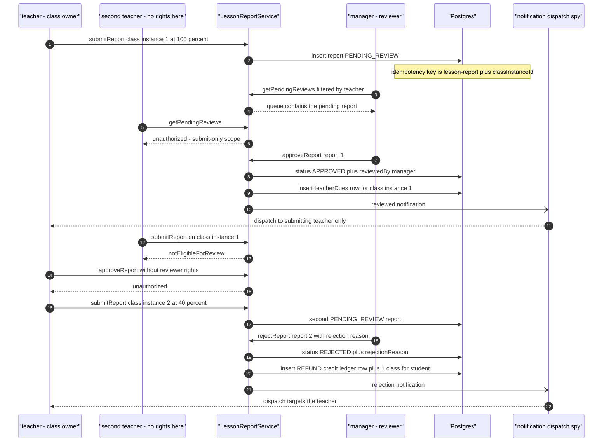

# Scheduling workflow journey diagrams

Mermaid diagram for the cross-actor journey suite in this directory, using the same actor names, service entry points, and statuses as the journey code.

## lesson-report-lifecycle.test.ts

A teacher submits lesson reports on their completed class instances and a manager reviews the queue: approval flips the report to APPROVED, creates the teacher due, and notifies only the submitting teacher; rejection flips the second report to REJECTED, writes a REFUND credit row for the student, and notifies the teacher. Cross-actor negatives are honest — a second teacher cannot submit on or review the class, and the teacher cannot approve.

