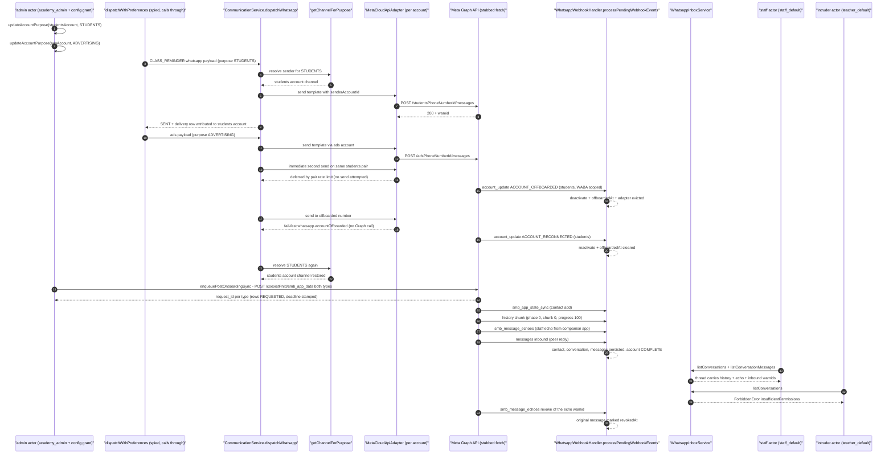

# WhatsApp workflow journey diagrams

Mermaid diagrams for the WhatsApp multi-number + coexistence journey suite in this directory. Each section maps to one test file; actor and step names mirror the real service calls in the suite.

## coexistence-routing.test.ts

The admin actor assigns purposes through the real account service; a routed CLASS_REMINDER lands on the students number with delivery attribution while an ads payload uses its own number and its own pair-limit key. Meta lifecycle webhooks offboard the students number (routing and direct sends fail fast) and later re-arm it on reconnect. The coexistence account's onboarding enqueues both one-shot syncs, history/state-sync/echo webhook chunks land in the inbox tables, staff read the thread through the inbox service, an actor without `whatsapp.inbox_view` is denied by real permission rows, and an app-side revoke echo marks the original message revoked.

